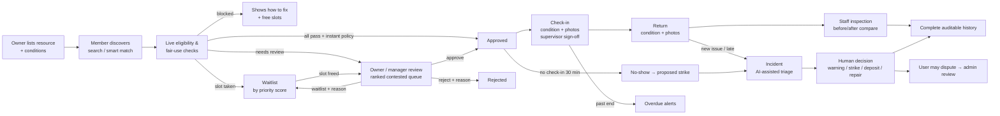
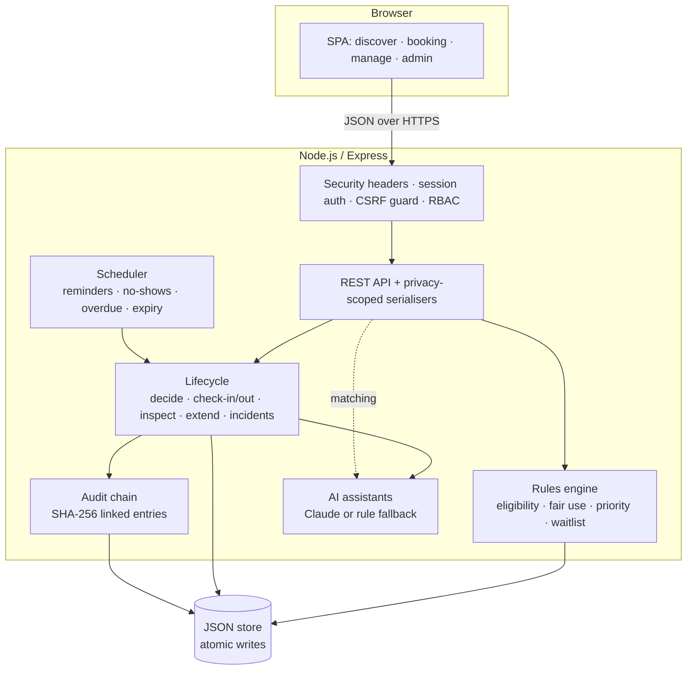

# LabLend — Project Document

**Problem statement:** Unlock Underused Equipment and Spaces
**One line:** A trusted platform that lets a university and its community partners safely share idle labs, studios, rooms and specialist equipment — with eligibility checks, fair allocation, condition records and an auditable history, while owners stay in control.

| | |
|---|---|
| Live product | `<add deployed URL>` |
| Source code | https://github.com/PragyaUniverse/lablend |
| Demo password (all accounts) | `demo1234` — see [README.md](README.md#testing-instructions-for-judges) |
| Team | unnatii.joshii · Jaypee Institute of Information Technology, Noida |

---

## 1. Selected use case

We focus on **one institution and its immediate community**: *Northfield University*, a fictional Indian university used as the demo setting, sharing resources from four departments (FabLab, Media Lab, Library learning spaces, Physics teaching labs) plus one verified community partner (*Northfield Makers Collective*) with:

- its own **students and researchers**, who often can't reach equipment held by other departments, and
- **verified community members** (local makers, early-stage teams), who can't afford to buy or privately rent the equipment.

We support three resource types with different risk profiles, because each needs different controls:

| Type | Examples in the demo | Key controls |
|---|---|---|
| Equipment used on site | Laser cutter, CNC router, 3D printer, oscilloscope bench, soldering station | Training records, staff supervision, condition checklists |
| Equipment borrowed and taken away | Cinema camera kit | Deposit, pick-up/return desk hours, overdue detection |
| Spaces and computing | Podcast studio, seminar room, remote GPU workstation | Capacity, high-demand limits, institutional approval for community use |

A reliable solution for one specific setting is more useful than an unfinished platform for every institution, so every rule in LabLend is configurable per resource by its owner rather than hard-coded.

## 2. Target users and resource owners

| Role | Who | What they need |
|---|---|---|
| **Member** | Students, researchers, verified community members | Find what fits their project, know *before* asking whether they qualify and why, get a fast decision with a reason, not be blamed for damage they didn't cause |
| **Resource owner** | Head of a lab/department, community-space founder | List resources with their own conditions; keep control of who uses them; see utilisation |
| **Lab manager** | Technicians, desk staff | Review requests quickly and fairly, supervise high-risk sessions, inspect returns, handle incidents |
| **Platform admin** | Research-infrastructure / facilities office | Verify identities and organisations, handle disputes, audit decisions, spot misuse |

## 3. Why the problem matters

Reasoning from how institutional equipment is typically managed:

- **Expensive assets sit idle.** Specialist kit (laser cutters, CNC machines, cinema cameras, GPU workstations) is bought for specific courses or grants. Outside those windows it is idle — evenings, weekends and semester breaks especially — yet the purchase cost is fixed.
- **Access is gated by people, not systems.** Today access usually depends on knowing the right technician, a paper sign-up sheet or an email thread. That excludes students from other departments and almost all community members, and leaves no record of who used what.
- **Ordinary booking calendars don't handle trust.** They show free slots but not *who is allowed* (training, supervision, user group), *what condition* the item was in, or *what happens* after damage or a no-show. Owners therefore say "no" by default — which is why resources stay idle.
- **Scarce resources get monopolised.** Without limits, a few frequent users block-book popular equipment and newcomers never get a slot.
- **Disputes are unresolvable without records.** If nobody recorded the condition at hand-over, damage can't be fairly attributed, so owners avoid lending.

> **Team action:** add your own evidence here before submitting — e.g. a short survey of classmates ("Have you needed equipment another department owns?"), a conversation with a lab technician about how bookings and damage are handled today, or photos of a paper sign-up sheet. Real local evidence scores well under *Understanding of the Problem*. We have deliberately not invented statistics.

## 4. Proposed solution

LabLend turns "ask the technician" into a transparent, rule-based process where **owners set the conditions, the system checks and explains them, and people make every decision that affects access, safety or penalties.**

What makes it more than a booking system:

1. **Eligibility before access** — each request is checked against identity verification, user group, required training records (with expiry), account standing, supervision and deposit rules. Every failed check tells the user *how to fix it*.
2. **Explainable allocation** — hard fair-use limits (weekly caps, one upcoming booking for high-demand items, platform-wide request cap, booking window) plus a *published* priority score for contested slots. Waitlists promote the highest-priority request automatically when a slot frees up.
3. **Condition records both ways** — checklist + photos at check-in and return; the platform automatically compares them and highlights only *new* issues, so users are never blamed for pre-existing damage.
4. **Human-in-the-loop accountability** — the system detects no-shows, late returns and damage and *proposes* actions; a manager confirms, changes or waives them; the affected person can dispute; disputes go to an admin.
5. **Tamper-evident history** — every approval, rejection, cancellation, extension, check-in, return, inspection, incident, verification and role change is recorded in a SHA-256 hash chain that anyone can verify.

## 5. Complete product workflow

Mapped to the ten lifecycle steps in the challenge:

| # | Challenge step | Where in LabLend |
|---|---|---|
| 1 | Owner lists a resource and defines conditions | Manage → *List a resource* (training, user groups, supervision, deposit, hours, caps, approval mode, rules, checklist) |
| 2 | User discovers and checks eligibility | Discover (filters, "only what I can use", smart match) → resource page shows a per-requirement eligibility checklist |
| 3 | User submits a booking request | Booking panel with live pre-check, priority score and suggested free slots |
| 4 | System verifies requirements | Rules engine re-runs all checks server-side; pending training blocks approval until a person verifies it |
| 5 | Owner/manager reviews | Ranked review queue grouping competing requests, with live eligibility and score breakdown |
| 6 | Approved / rejected / waitlisted | Decisions require a reason; rivals auto-waitlisted with an explanation; waitlist auto-promotion |
| 7 | Check-in with initial condition | Checklist + photos; supervised equipment needs a staff sign-off |
| 8 | Return with final condition | Checklist + photos; lateness computed; extensions checked against the next booking |
| 9 | Delay, damage, conflict handled | Automatic incidents for new damage, late returns and no-shows; manual reports; triage summary; human resolution; disputes |
| 10 | Both parties see full history | Booking timeline + incident history from the hash-chained audit log; Activity page with chain verification |

## 6. Features developed during the hackathon

**Members**
- Discover with search, type/location filters and "only show what I can use"
- Smart match: describe a need in plain language → ranked resources with reasons (Claude when configured, keyword rules otherwise)
- Resource page: requirements vs. your status, rules, condition checklist, 7-day availability calendar (other users anonymised), demand indicators
- Live pre-check while choosing a slot: outcome (instant / review / waitlist / blocked), every check with a fix, priority score breakdown, nearby free slots
- Booking lifecycle: cancel (late-cancellation warning), check-in, extension request, return, issue reporting, lifecycle stepper, decision reasons
- Profile: identity & standing, training records (submit for verification), privacy summary, **download all my data**
- In-app notifications: confirmations, approvals, rejections, waitlist moves/promotions, reminders, overdue, no-shows, incidents, verification results

**Owners & managers**
- Listing editor with all access conditions; pause for maintenance / reopen (with reason)
- Review queue that groups contested requests and ranks them by priority score
- In use & returns: overdue detection, supervision sign-off, before/after inspection, extension decisions
- Training-record verification with automated advisory checks (ID format, issuer, dates, **duplicate certificate across accounts**)
- Incidents: triage summary, condition comparison, proposed action, resolution (no action, warning, strike, deposit deduction, repair/pause), statements
- Insights: utilisation, idle hours, community hours, unique users, top-user share, decision time, no-shows; explainable usage-pattern flags

**Admins**
- Identity verification, restrict/restore access, role & organisation assignment, clear strikes — all with recorded reasons
- Dispute review with automatic reversal of earlier penalties
- Platform-wide usage flags, organisation verification status
- Audit log with integrity verification and CSV export

**Platform**
- Scheduler (reminders, no-shows, overdue, request expiry) running on every API call and every 30 s
- Demo mode: one-click personas, demo clock (+15 min / +1 h / +1 day / jump to my next booking), regenerate demo data
- Automated end-to-end test suite (`npm test`)
- Public landing page built from live data: product showcase that plays a booking through its lifecycle, featured resources, how it works, role overview, safety and fair-access sections, live 30-day figures and one-click demo personas

**Design and usability**
- Role-based navigation: a sidebar on desktop (grouped into Operations, Resources, Platform and Transparency, with live counts) and a top bar with a slide-in menu on phones
- Dashboards per role that answer "what do I have booked, what needs my attention, what can I do next"
- Original illustration set: technical-drawing style SVG artwork for every type of equipment and space, adapting to both themes
- Light (warm ivory) and dark (deep forest) themes with a toggle that remembers the choice
- Motion with purpose: page transitions, staggered cards, animated dialogs and notifications, skeleton loading states; all disabled for users who prefer reduced motion
- Accessible by default: semantic HTML, labelled controls, keyboard navigation, visible focus, no horizontal scrolling on phones

## 7. Technology stack and system architecture

| Layer | Choice | Why |
|---|---|---|
| Server | Node.js 20 + Express 4 | Simple, widely understood, runs anywhere |
| Persistence | In-memory document store with atomic JSON file writes | Zero native dependencies → reliable deploys on free hosting; easy to swap for PostgreSQL |
| Front end | Vanilla JavaScript ES modules, hand-written CSS design system, inline SVG illustrations and icons, no build step | Fast to load, nothing to break at deploy time |
| Typography | Geist, Geist Mono and Instrument Serif (Google Fonts) | Readable interface type with a distinctive accent |
| Auth | Email + password (scrypt hashes), random session tokens stored hashed, HttpOnly SameSite cookies | No third-party identity needed for the demo; SSO slot ready (see future work) |
| AI (optional) | Anthropic Claude via the official `@anthropic-ai/sdk`, structured JSON outputs | Advisory matching, triage and certificate notes |
| Tests | `node:test` end-to-end suite against a real server + throwaway DB | Verifies the full lifecycle and the safety rules |
| Hosting | Render blueprint (`render.yaml`) or Docker | One-click deploy |

**Key data flows**
- *Request:* browser sends the wall-clock slot → server converts it in the institution's timezone → `evaluate()` runs eligibility + slot checks + conflict detection + priority → outcome → booking stored with a snapshot of the checks → audit entry → notifications.
- *Decision:* server re-checks eligibility and conflicts at approval time (state may have changed), then displaces overlapping pending requests to the waitlist with an explanation.
- *Time-based rules:* a lazy scheduler runs before every API call (and on a timer), so no-shows, overdue returns and expiries are detected even on free hosting that sleeps.
- *Seed data:* generated by replaying the real lifecycle functions at simulated past times, so demo history, notifications and the audit chain are internally consistent.

## 8. AI tools, APIs, frameworks and external services

**In the product (optional, advisory only):** When `ANTHROPIC_API_KEY` is set, LabLend calls Claude (`claude-opus-5-5`, low effort, structured JSON output, with Anthropic's server-side refusal fallback enabled) for:

| Feature | What the AI does | What it never does |
|---|---|---|
| Smart match | Ranks resources against a plain-language need and explains the fit | Decide eligibility — LabLend's rules check that separately |
| Incident triage | Neutral summary, suggested severity, key facts from the records, next steps | Assign blame or apply any penalty |
| Certificate review | Adds up to two consistency notes to the rule-based checks | Approve or reject a training record |

Without a key (and if a call fails), each feature falls back to a deterministic, explainable rule-based version, so the product always works and judges see the same behaviour. The UI labels which source produced each suggestion and that a person decides.

**Libraries:** Express (MIT), `@anthropic-ai/sdk` (optional dependency). No UI frameworks, CSS frameworks or templates.

**External services:** Google Fonts (typefaces only). Anthropic API only if configured.

**Development tools:** Claude Code (Anthropic's AI coding assistant) was used to build the application and documentation; see section 14.

## 9. Privacy, security and fairness

**Privacy**
- Data minimisation: only what is needed to decide access — name, email, user group, training records, booking purpose, condition notes/photos.
- Other members only ever see "Booked"/"Requested" on calendars — never names or purposes.
- Booking purposes, contact details and condition photos are visible only to the requester, staff of *that* resource's organisation, and admins. Training evidence is visible only to staff who verify that training.
- Activity history is scoped: members see entries about their own bookings/incidents; staff see their organisation's; admins see everything.
- Identity verification stores only the method ("Photo ID checked by …"), never the document.
- Users can download all data held about them (JSON export).
- Demo data is entirely fictional.

**Security**
- Passwords hashed with scrypt + per-user salt; constant-time comparison.
- Session tokens are 256-bit random values, stored only as SHA-256 hashes, sent in HttpOnly, SameSite=Lax cookies (Secure behind HTTPS), 12-hour expiry.
- CSRF hardening: state-changing API calls must be JSON and same-origin.
- Role- and organisation-based authorisation enforced server-side on every action (e.g. a FabLab manager cannot verify Media Lab training or approve Media Lab bookings).
- Strict Content-Security-Policy (no inline scripts, no third-party origins), `X-Frame-Options: DENY`, `nosniff`, strict referrer policy.
- All user content is HTML-escaped on render; input lengths and types validated server-side; uploaded photos restricted to small JPEG/PNG/WebP data URLs and resized client-side.
- Login rate limiting.
- Tamper-evident audit chain: editing or deleting any past entry breaks verification.

**Fairness**
- Published, uniform rules (see the in-app *Fair use* page): platform-wide open-request cap, per-resource weekly caps, one-upcoming-booking rule for high-demand resources, booking windows.
- Contested slots ranked by a transparent score anyone can see on their own request: lower recent use, first-time users and coursework/research purposes get priority; confirmed strikes reduce it.
- Waitlists promote the highest-priority request automatically — no refresh races.
- Owners can override the ranking but must write a reason the requester reads.
- Penalties are never automatic: the system proposes, a person confirms, the user can dispute, an admin reviews.
- Insights show utilisation, community hours and the largest single-user share per resource so owners can tune caps.

**Accessibility**
- Semantic HTML, labelled form controls, skip link, visible focus states, ARIA live regions for status messages, keyboard-operable dialogs, `prefers-reduced-motion` and light/dark themes; layouts work at phone width.

## 10. Known limitations

- **Persistence:** a single JSON file is fine for a pilot but not for multi-instance deployments; on free hosting with ephemeral disks, data resets on restart (intentional for the demo).
- **Notifications** are in-app only; no email/SMS delivery yet.
- **Identity** uses demo passwords; production would use the university's SSO.
- **Deposits** are tracked as states, not real payments.
- **Photos** are stored inline (small, compressed); production would use object storage.
- **Recurring bookings** (e.g. weekly lab sessions) and multi-unit resources (5 identical printers as one listing) are not yet supported.
- **Demo clock** can move forward only; moving it changes "now" for everyone using the same deployment.
- Rule-based smart matching is keyword-based when no AI key is configured.

## 11. Future development

- University SSO (SAML/OIDC) and automatic sync of training records from the safety-induction register
- PostgreSQL with row-level security; object storage for photos
- Email/SMS/WhatsApp notifications and calendar (ICS) feeds
- QR codes on equipment for one-tap check-in/out and condition photos
- Multi-institution federation: partner universities share resources under agreed rules and reciprocal credits
- Credit-based or cost-recovery pricing for community and start-up use; integration with institutional billing for deposits
- Recurring bookings and multi-unit resources
- Utilisation reports that justify future purchases (e.g. "this camera was idle for most of its open hours last term")

## 12. Testing instructions and credentials

Open the live link, click **Explore resources** or **Sign in**, and choose a sample user. All accounts use the password **`demo1234`**. The Home page shows an 8-step walkthrough of the complete lifecycle. Use the floating **Demo** button (bottom-right) to switch user, move the clock forward (to trigger check-in windows, no-shows and overdue returns), or regenerate fresh demo data. If the data looks stale, click **Regenerate data**.

| Sample user | Email | Role |
|---|---|---|
| Aisha Khan | aisha@northfield.edu | Student |
| Sameer Patel | sameer@northfield.edu | Lab manager (FabLab, Physics) |
| Dr. Meera Iyer | meera@northfield.edu | Resource owner (FabLab) |
| Priya Nair | priya@northfield.edu | Platform admin |
| Anand Kulkarni | anand@northfield.edu | Owner (Media Lab, Library) |
| Rohan Mehta | rohan@makers.community | Community maker |
| Kavya Reddy | kavya@northfield.edu | Researcher |
| Arjun Fernandes | arjun@northfield.edu | Student with one strike |
| Ishaan Malhotra | ishaan@gmail.example | New community member (unverified) |
| Farhan Qureshi | farhan@makers.community | Makerspace owner |

Automated tests: `npm install && npm test` (7 end-to-end tests covering the full lifecycle, eligibility, permissions, disputes and the audit chain).

## 13. Team and participants

**Team unnatii.joshii** · Jaypee Institute of Information Technology (JIIT), Noida · B.Tech Computer Science & Engineering, 3rd year

| Name | Role | Email | Share |
|---|---|---|---|
| Unnati Joshi | Team leader, co-developer | unnatii.joshii@gmail.com | 50% |
| Pragya Sumbly | Member, co-developer | pragyasumbly5296@gmail.com | 50% |

Both members contributed equally and worked jointly on every part of the project: defining the use case and the eligibility, fair-allocation and accountability rules; designing the experience for students, lab managers, owners and administrators; building and testing the booking workflow, review queue, check-in/return, condition records and incident handling; and writing this document. Unnati additionally coordinated the team and the final submission; Pragya set up the repository and the deployment.

## 14. Disclosure of templates, libraries, existing components and AI use

- **Templates / pre-existing code:** none. No UI kits, starter templates or code from earlier projects.
- **Open-source libraries:** Express (MIT) for HTTP routing; `@anthropic-ai/sdk` (MIT, optional) for the Claude API. Everything else uses Node.js built-ins (`crypto`, `fs`, `node:test`) and browser APIs.
- **Assets:** all illustrations and icons are original SVG drawn for this project. Fonts (Geist, Geist Mono, Instrument Serif) are loaded from Google Fonts under the SIL Open Font License. No stock photos or third-party images.
- **AI-assisted development:** the application code, demo data, tests and documentation were produced with substantial assistance from Claude Code (Anthropic's AI coding assistant), directed, reviewed and tested by the team during the hackathon window. *(Team: adjust this sentence so it accurately describes how you worked.)*
- **AI in the product:** optional Anthropic Claude API for advisory matching, incident triage and certificate notes (see section 8).
- **Data:** all people, organisations and records in the demo are fictional.
